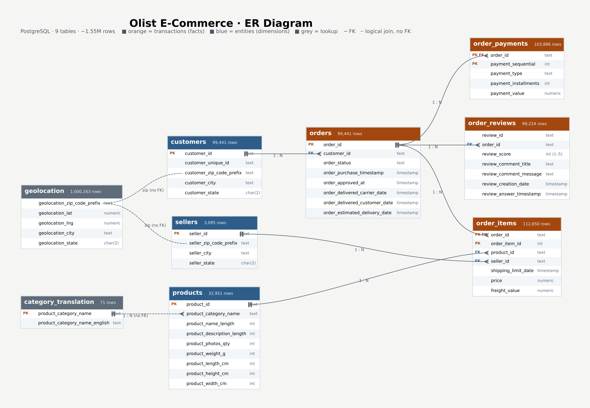

# Olist E-Commerce Sales Analysis (SQL + Power BI)

> 🚧 **Work in progress**: data model and loading scripts are done; analysis queries and the Power BI dashboard are being added.

An end-to-end analysis of **~100,000 real orders** from Olist, a Brazilian e-commerce marketplace (2016–2018). The data is loaded into **PostgreSQL**, analysed with **SQL** (JOINs, CTEs, window functions) and visualised in a **Power BI** dashboard.

**Dataset:** [Brazilian E-Commerce Public Dataset by Olist](https://www.kaggle.com/datasets/olistbr/brazilian-ecommerce) (Kaggle, CC BY-NC-SA 4.0). 9 related tables: orders, items, payments, reviews, customers, sellers, products, geolocation and category translations.

## Business questions

| # | Question | SQL techniques |
|---|---|---|
| 1 | How did revenue and order volume change month by month? | `DATE_TRUNC`, `LAG` |
| 2 | Which product categories generate the most revenue? | multi-table `JOIN`, `GROUP BY` |
| 3 | Which states and cities bring the most revenue? | `JOIN`, `RANK` |
| 4 | How often are orders delivered late, and where? | date arithmetic, `CASE` |
| 5 | Do late deliveries lead to lower review scores? | `CTE`, conditional aggregation |
| 6 | Which payment methods and installment plans do customers use? | `GROUP BY`, percentages |
| 7 | How many customers come back for a second purchase? | `COUNT(DISTINCT)`, `CTE` |
| 8 | Who are the top sellers in each state? | `RANK() OVER (PARTITION BY ...)` |

## Key insights

_Coming soon._

## Data model



9 tables, ~1.55M rows. `orders` and `order_items` are the core transaction tables; `customers`, `products` and `sellers` describe who bought, what and from whom. `category_translation` and `geolocation` are lookups joined on category name and zip code (no foreign key).

## Repository structure

```
sql/
  01_create_tables.sql          # table definitions (primary keys, data types)
  02_load_data.psql             # loads the 9 CSV files with \copy
  03_constraints_and_checks.sql # foreign keys, indexes, row-count validation
  analysis/                     # one file per business question (coming soon)
dashboard/                      # Power BI file and screenshots (coming soon)
docs/erd.png                    # ER diagram
practice/                       # SQL warm-up exercises
```

## How to reproduce

1. Download the dataset from Kaggle and extract it to `C:/olist`.
2. Create a PostgreSQL database called `olist`.
3. Run `sql/01_create_tables.sql` in pgAdmin's Query Tool.
4. Open pgAdmin's **PSQL Tool** on the `olist` database and paste `sql/02_load_data.psql`.
5. Run `sql/03_constraints_and_checks.sql`: every table should show `OK`.

## Tools

PostgreSQL 17 · pgAdmin 4 · Power BI Desktop
